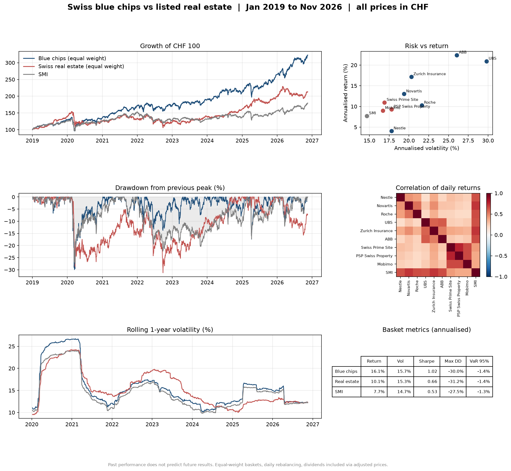

# Swiss Blue Chips vs Listed Real Estate: Portfolio Dashboard

A one-page risk and return dashboard comparing two equal-weight baskets of SIX-listed stocks against the SMI index. All prices are in CHF, so currency effects do not distort the comparison.

## Question

Have listed Swiss real estate companies behaved differently from Swiss blue chips in terms of return, risk and drawdowns?

## Data

- Source: Yahoo Finance via `yfinance` (adjusted close, dividends included)
- Blue chips: Nestle, Novartis, Roche, UBS, Zurich Insurance, ABB
- Real estate: Swiss Prime Site, PSP Swiss Property, Mobimo
- Benchmark: SMI index
- Period: set in `dashboard.py` (`START`, `END`)

Baskets are equal weight with daily rebalancing. Only dates where all series have a price are used.

## Metrics

| Metric | Definition |
|---|---|
| Annualised return | Compound annual growth rate over the period |
| Annualised volatility | Standard deviation of daily returns x sqrt(252) |
| Sharpe ratio | (Annualised return - risk-free rate) / volatility. Risk-free rate is set to 0 by default and can be changed in the config |
| Max drawdown | Largest fall from a previous peak |
| Daily VaR 95% | Historical 5th percentile of daily returns |

## Dashboard panels

1. Growth of CHF 100 (both baskets and the SMI)
2. Risk vs return by single stock
3. Drawdowns from previous peak
4. Correlation matrix of daily returns
5. Rolling 1-year volatility
6. Summary table of basket metrics

## How to run

```bash
pip install -r requirements.txt
python dashboard.py            # downloads prices on first run, then builds the dashboard
python dashboard.py --refresh  # force a fresh download
python dashboard.py --csv my_prices.csv   # use your own price file
```

Output is written to `output/dashboard.png` and `output/metrics.csv`. Downloaded prices are cached in `data/prices.csv`.

To test other stocks or another period, edit the config block at the top of `dashboard.py`.

## Results



Between January 2019 and November 2026, the equal-weight blue chip basket returned 16.1% per year, compared with 10.1% for listed real estate and 7.7% for the SMI. Volatility was close across the three (15.7%, 15.3% and 14.7%), so the Sharpe ratio ranked blue chips first (1.02), real estate second (0.66) and the SMI last (0.53), using a risk-free rate of 0. Maximum drawdowns were similar, between 27.5% and 31.2%. The three real estate stocks moved closely together and were visibly less correlated with the blue chips. Among single stocks, ABB and UBS had the highest returns and volatility, while Nestle had the lowest return.

## Limitations

- Historical data only. Past performance does not predict future results.
- Ten series (nine stocks and the SMI) are a small sample, not a representative index of each sector.
- Stocks were selected with hindsight, so the blue chip result is flattered by the current winners such as ABB and UBS.
- Equal weights differ from the SMI's market-cap weights, so the baskets and the index are not like-for-like.
- Equal weights with daily rebalancing ignore trading costs and taxes.
- Real estate equities trade like stocks and are not the same as direct property investment.
- Yahoo Finance data can contain errors or gaps and should be checked before serious use.
